  

# 🧪 Awesome Test Execution Log Aggregation & Analysis 📊

  
  
  
  
  
  

> 🚀 **A curated, battle-tested list of leading Test Execution Log Aggregation, Centralized Log Management, and CI/CD Pipeline Analytics platforms.**
> Discover best-in-class hosted SaaS suites and self-hosted open-source software (OSS) to consolidate test runs, debug flaky failures, automate AI-driven root cause analysis (RCA), and optimize automated testing workflows.
> 
> 🌟 *Star this repository if you find it valuable for scaling your QA, DevOps, and TestOps infrastructure!* 🌟

---

## 📋 Table of Contents 📑

- [🌐 Sector Overview & Market Dynamics](#-sector-overview--market-dynamics)
- [🟦 SaaS / Hosted Platforms](#-saas--hosted-platforms)
- [🟩 Open-Source Software](#-open-source-software)
- [📊 Feature Comparison at a Glance](#-feature-comparison-at-a-glance)
- [📈 Star History](#-star-history)
- [💖 Support & Sponsorship](#-support--sponsorship)
- [🤝 Contributing](#-contributing)
- [📄 License](#-license)

---

## 🌐 Sector Overview & Market Dynamics 📈

The global log management, test observability, and CI/CD telemetry analysis sector is currently estimated at approximately **$3.7B to $4.3B USD** and is projected to expand toward **$8B to $10B USD** over the next decade at a CAGR of 11%–15%. This rapid trajectory is fueled by massive test suite execution volumes in continuous integration pipelines, microservices architectures, cloud-native deployments, and strict enterprise compliance standards. 

The market is currently **moderately fragmented** among developer utilities, test reporting servers, and open-source collectors, but is experiencing rapid **consolidation into concentrated enterprise giants** (exemplified by Cisco's landmark $28B acquisition of Splunk, and comprehensive full-stack telemetry consolidation across Datadog and Dynatrace). In this environment, enterprise buyers increasingly favor unified observability matrices that connect test failure logs with production tracing, APM, and SIEM security telemetry.

---

## 🟦 SaaS / Hosted Platforms ☁️

Commercial, cloud-hosted Test Execution Log Aggregation and Analytics platforms, sorted in descending order of company size (valuation / revenue).

| 🏢 Platform | 💰 Company Size (Valuation / Revenue) | 🏷️ Starting Price | 🎁 Free Tier Limits / Trial Limits | 🎯 Primary Category |
|---|---|---|---|---|
| **Datadog Log Management** | ~$68B Market Cap / ~$4.3B TTM Revenue | Ingest: $0.10/GB; Searchable retention: $1.06–$2.50+ per 1M log events/mo | 14-day free trial with full access to log ingestion & indexing; no permanent free tier for log explorer (free tier covers 5 infra hosts only) | 🔍 General log management & APM test correlation |
| **Splunk Cloud** | $28B (Acquired by Cisco) / ~$3.9B Annual Revenue | Custom quote / Workload SVC model (or ~$1,200–$2,000+ per GB/day/yr list rate) | 14-day free trial limited to 5 GB/day ingest (or perpetual on-prem Splunk Free capped at 500 MB/day) | 🛡️ Enterprise log indexing, compliance & SIEM |
| **BrowserStack Test Observability** | $4.0B Valuation / ~$200M–$225M ARR | Pro starts at ~$0.0079 per test execution (usage-based) | Unlimited Free Plan: free test log aggregation & basic flaky detection for CI runs; 30–60 min cap applies if using automated device cloud | 🧪 Dedicated test execution log debugging & analytics |
| **Sumo Logic** | $1.7B (Acquired by Francisco Partners) / ~$300M Revenue | Essentials credit tier starts at ~$0.15 per credit (flexible consumption) | 30-day free trial with up to 5 GB/day burst ingestion and full dashboard access; no credit card required | 🧠 Cloud-native log analytics & DojoAI root cause |
| **Coralogix** | $1.6B Valuation / ~$90M+ ARR | In-stream logs start at $0.42/GB (monitoring at ~$0.50/GB, archive at $0.17/GB) | 14-day free trial with unrestricted access to all ingestion pipelines, unlimited users and data sources; no permanent free tier | ⚡ Full-stack observability with in-stream log analysis |
| **Mezmo (LogDNA)** | $370M Valuation / ~$34M ARR | Data ingestion: $0.20/GB; 30-day retention: $0.20/GB/month | 30-day free trial of telemetry pipelines and parsing rules; custom usage quotas configurable in app | 🔀 Telemetry pipeline with AI-ready log context |
| **Better Stack Logs** | ~$74M–$93M Valuation / ~$3.5M–$3.8M ARR | Nano bundle starts at $25/month (or $0.10/GB ingest + $0.05–$0.10/GB retention) | Free forever plan: 3 GB logs/month with 3-day retention, 3 GB traces, and 10 uptime monitors | 💾 ClickHouse-backed structured log querying & SQL |
| **Papertrail** | SolarWinds Subsidiary / ~$150K–$1M Niche Run-rate | Starting tier: $5.00/month for 1 GB log transfer | Free forever plan: 50 MB log transfer per month (with 48-hour search retention and 7-day archive) | 📜 Cloud log management & CLI live-tailing |

---

## 🟩 Open-Source Software 🔓

Self-hosted, community-driven log management, telemetry pipelines, and automated test reporting systems. Sorted by GitHub star count in descending order.

| 📦 Repository & Project | ⭐ Popularity | 💻 Tech Stack | 📜 License | 📝 Architectural Focus & Capabilities |
|---|---|---|---|---|
| [**Elasticsearch**](https://github.com/elastic/elasticsearch) |  | Java | Elastic License 2.0 / SSPL | 🔎 Distributed, RESTful search and analytics engine powering the ELK stack for high-throughput test log indexing. |
| [**SigNoz**](https://github.com/SigNoz/signoz) |  | Go, TypeScript, ClickHouse | Apache 2.0 / Commercial | 🔭 OpenTelemetry-native observability platform providing unified logs, traces, and metrics with columnar ClickHouse storage. |
| [**Grafana Loki**](https://github.com/grafana/loki) |  | Go | AGPL-3.0 | 🗄️ Like Prometheus, but for logs. Indexes only label metadata rather than message payloads to slash operational and storage costs. |
| [**OpenObserve**](https://github.com/openobserve/openobserve) |  | Rust | AGPL-3.0 | 🦀 Cloud-native, high-efficiency observability platform for logs, metrics, and traces with ultra-low storage consumption. |
| [**Vector**](https://github.com/vectordotdev/vector) |  | Rust | MPL-2.0 | 🚀 Ultra-fast, lightweight observability data pipeline for collecting, parsing, transforming, and routing CI/CD test logs. |
| [**Fluentd**](https://github.com/fluent/fluentd) |  | Ruby, C | Apache 2.0 | 🧩 CNCF-graduated log collector offering unified data abstraction and an extensive ecosystem of 500+ routing plugins. |
| [**Fluent Bit**](https://github.com/fluent/fluent-bit) |  | C | Apache 2.0 | ⚡ High-performance, low-footprint log and metric forwarder (~4MB binary) optimized for container and Kubernetes CI runners. |
| [**Graylog**](https://github.com/Graylog2/graylog2-server) |  | Java, MongoDB, OpenSearch | GPLv3 (Open) / Commercial | 🛡️ Scalable centralized log aggregator featuring processing pipelines, alerting rules, and flexible search dashboards. |
| [**OpenTelemetry Collector**](https://github.com/open-telemetry/opentelemetry-collector) |  | Go | Apache 2.0 | 🌐 Vendor-neutral proxy and pipeline engine to ingest, filter, batch, and export test telemetry across multiple backends. |
| [**Allure Report**](https://github.com/allure-framework/allure2) |  | Java | Apache 2.0 | 📑 Multi-language test reporting framework capturing rich execution logs, console traces, screenshots, and test suite breakdowns. |
| [**ReportPortal**](https://github.com/reportportal/reportportal) |  | Java, React, PostgreSQL | Apache 2.0 | 🤖 AI-powered test automation dashboard for real-time test run aggregation, log consolidation, and automated flaky failure triage. |

---

## 📊 Feature Comparison at a Glance 🔍

| Platform / Tool | 📜 License | 🏷️ Type | 🎯 Test-Session Aware | 🏠 Self-Hosted | 💡 Ideal Use Case |
|---|---|---|---|---|---|
| **BrowserStack Test Observability** | Proprietary | Test Log Aggregation | ✅ | ❌ | Consolidated test failure triage, flaky tagging & video/log sync |
| **ReportPortal** | Apache 2.0 | Test Analytics & Logs | ✅ | ✅ | Open-source CI test execution reporting & ML-based triage |
| **Allure Report** | Apache 2.0 | Test Reporting & Logs | ✅ | ✅ | Beautiful visual test execution reports & granular step logging |
| **Datadog Logs** | Proprietary | General Log Management | ❌ | ❌ | Correlating CI/CD logs with backend traces & APM |
| **Splunk Cloud** | Proprietary | Enterprise Log / SIEM | ❌ | ❌ | Enterprise compliance retention, security analytics & SPL querying |
| **Sumo Logic** | Proprietary | Cloud Log Analytics | ❌ | ❌ | Automated anomaly detection & DojoAI root cause diagnosis |
| **Mezmo** | Proprietary | Telemetry Pipeline | ❌ | ❌ | High-volume telemetry transformation & AI-ready context prep |
| **Better Stack Logs** | Proprietary | Structured Log Aggregation | ❌ | ❌ | Fast ClickHouse SQL querying with integrated uptime status pages |
| **Coralogix** | Proprietary | Full-Stack Observability | ❌ | ❌ | In-stream data routing & predictable per-GB log budgeting |
| **Papertrail** | Proprietary | Simple Log Management | ❌ | ❌ | Lightweight instant console log search & CLI live tailing |
| **Elasticsearch (ELK)** | Elastic 2.0 | Distributed Search Engine | ❌ | ✅ | Deep full-text query capabilities across petabyte-scale test logs |
| **SigNoz** | Apache 2.0 / Commercial | Full-Stack Observability | ❌ | ✅ | Native OpenTelemetry integration with fast ClickHouse backend |
| **Grafana Loki** | AGPL-3.0 | Label-Indexed Log Store | ❌ | ✅ | Low-cost Kubernetes log ingestion natively visualised in Grafana |
| **OpenObserve** | AGPL-3.0 | Rust Telemetry Platform | ❌ | ✅ | Resource-efficient alternative to Datadog/Elasticsearch |
| **Vector** | MPL-2.0 | Data Pipeline Agent | ❌ | ✅ | Blazing fast log parsing, enrichment, and cross-backend forwarding |
| **Graylog** | GPLv3 (Open) | Log Management Server | ❌ | ✅ | Reliable log centralization with enterprise audit and security rules |
| **Fluentd / Fluent Bit** | Apache 2.0 | Log Forwarder & Router | ❌ | ✅ | Ubiquitous containerized log shippers across CI cluster nodes |
| **OpenTelemetry Collector**| Apache 2.0 | Telemetry Proxy | ❌ | ✅ | Standardizing test runner traces, metrics, and logs across vendors |

---

## 📈 Star History

---

## 💖 Support & Sponsorship ☕

If this curated repository saved you hours of research or helped you architect better test observability for your pipelines, please consider supporting the project:

- ⭐ **Star this repository** on GitHub to support discoverability!
- 🍴 **Fork it and contribute** missing tools, case studies, or benchmarks!
- 📢 **Share it** with your fellow QA engineers, SREs, and DevOps teams!
- ☕ **Buy me a coffee / Sponsor the project**: Support continuous open-source curation directly through the [GitHub Sponsors Dashboard](https://github.com/sponsors/ishandutta2007). Your support helps keep this guide comprehensive, up-to-date, and free for the developer community!

---

## 🤝 Contributing 🛠️

Contributions are warmly welcome! If you know of an outstanding open-source tool or commercial platform tailored for test execution log aggregation, analysis, or test observability that should be featured here:

1. Fork this repository.
2. Check existing entries to ensure no duplicates.
3. Submit a Pull Request with the project name, official URL, stack, license, and a concise summary of why it stands out.

Please review our [Awesome List Guidelines](https://github.com/ishandutta2007/Awesome-Awesome-Awesome) for quality benchmarks.

---

## 📄 License ⚖️

This curated compilation is dedicated to the public domain under the [Creative Commons Zero v1.0 Universal (CC0-1.0)](https://creativecommons.org/publicdomain/zero/1.0/) license. Individual products, software packages, logos, and trademarks mentioned belong to their respective creators and organizations.

---

  <b>Built with ❤️ for Test Engineers, SREs, and DevOps Teams worldwide.</b> 
  🌟 <i>Don't forget to star the repository if you found it useful!</i> 🌟

